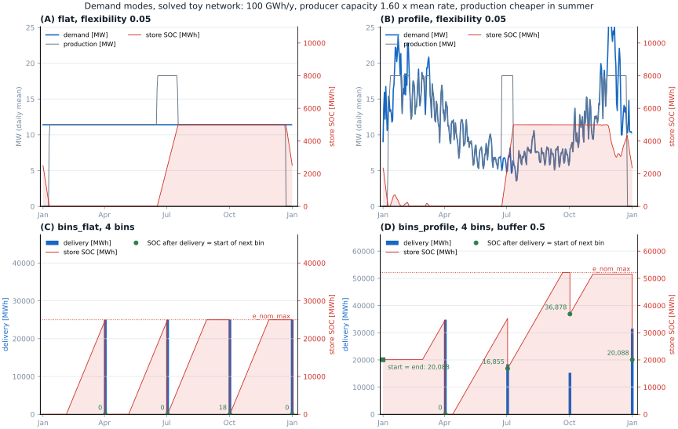

.. _guide-demands:

Setting Product Demands
=======================

GreenBubble supports four **demand modes** per product. Each mode controls the
shape of the demand time series and whether (and how large) a **flexibility
store** (delivery buffer) is added to the network.

The demand system is configured entirely in ``config/config.yaml`` under the
``targets`` key.  Seasonal profiles for ``profile`` and ``bins_profile`` modes
are loaded from ``data/common/``, a year-agnostic folder separate from the
per-year ``data/Inputs_{year}/`` directories.

----

Demand modes at a glance
-------------------------

   The four modes solved on a toy network: 100 GWh/y, one producer at 1.6 times
   the mean rate, production cheaper in summer. Green dots mark the state of
   charge left after each delivery, which is where the next bin starts.
   Generated by ``docs/_static/demands/generate_demand_figures.py``.

.. list-table::
   :header-rows: 1
   :widths: 18 32 18 32

   * - Mode
     - Demand TS
     - Store added?
     - Store ``e_nom_max``
   * - ``flat``
     - constant rate (annual / 8760)
     - if ``flexibility > 0``
     - ``flexibility × annual``
   * - ``profile``
     - scaled NG seasonal profile
     - if ``flexibility > 0``
     - ``flexibility × annual``
   * - ``bins_flat``
     - equal spike at each bin end
     - always
     - ``annual / n_bins``
   * - ``bins_profile``
     - profile-weighted spike at each bin end
     - always
     - ``max_bin × (1 + buffer)``

----

Configuration keys
------------------

For each product (``CH4``, ``H2``, ``MeOH``) the following keys live inside
the ``targets`` block of ``config/config.yaml``:

.. code-block:: yaml

   targets:
     # ── bioCH4 ──────────────────────────────────────────────────────────
     demand_CH4: 300000          # MWh/year  (or max production if driver='price')
     CH4_demand_mode: flat       # flat | profile | bins_flat | bins_profile
     CH4_bins: 1                 # number of equal time bins (ignored for flat/profile)
     CH4_flexibility: 0.02       # fraction of annual demand used as store e_nom_max
                                 # (only for flat/profile; 0 = rigid, no store)

     # ── H2 ──────────────────────────────────────────────────────────────
     demand_H2: 0
     H2_demand_mode: bins_flat
     H2_bins: 1
     H2_flexibility: 0.0

     # ── Methanol ─────────────────────────────────────────────────────────
     demand_meoh: 4000
     MeOH_demand_mode: bins_flat
     MeOH_bins: 1
     MeOH_flexibility: 0.0

     # ── shared ──────────────────────────────────────────────────────────
     demand_store_buffer: 0.0    # extra headroom for bins_profile stores

     # ── seasonal profiles (only relevant for profile / bins_profile modes) ──
     # null  → use data/common/NG_demand_DK_profile.csv (seeded automatically)
     # path  → any semicolon-separated CSV in data/common/ or elsewhere
     CH4_profile: null
     H2_profile: null
     MeOH_profile: null

----

Mode details
------------

``flat`` — constant delivery
^^^^^^^^^^^^^^^^^^^^^^^^^^^^^

The product is demanded at a **constant MW rate** throughout the year:

.. code-block::

   rate = annual_demand / 8760  [MW]

A **flexibility store** is added when ``flexibility > 0``. Its maximum capacity
is ``flexibility × annual_demand`` MWh. The store is cyclic, so the optimiser
can shift some production within the year while meeting the total annual demand.
Setting ``flexibility = 0`` makes the demand completely rigid (no store).

**Typical use:** biogas-derived CH4 with a small intra-day buffer
(``flexibility ≈ 0.01–0.05``).

``profile`` — seasonally shaped delivery
^^^^^^^^^^^^^^^^^^^^^^^^^^^^^^^^^^^^^^^^^

The demand is shaped by the Danish natural-gas consumption seasonal profile
(winter-heavy). The profile is normalised so the annual total equals
``annual_demand``. A flexibility store is added under the same rules as
``flat``. The reference profile can be changed by the user

**Typical use:** products sold to the NG grid with seasonal off-take variation.

``bins_flat`` — periodic equal deliveries
^^^^^^^^^^^^^^^^^^^^^^^^^^^^^^^^^^^^^^^^^^

The year is divided into ``n_bins`` equal time windows. At the **end** of each
bin a single delivery of ``annual_demand / n_bins`` MWh is required. Between
deliveries the demand is zero, and the optimiser accumulates product in the
delivery buffer store.

The delivery is a ``Load`` on the same bus as the store, so the store balance at
a bin end is

.. code-block::

   e(t_end) = e(t_end - 1) + production(t_end) - delivery

The next bin starts from ``e(t_end)``. Nothing resets the store to zero.

The delivery store ``e_nom_max`` is set to ``annual / n_bins`` (one bin's worth).
The store must hold the whole delivery just before the bin end, so it is empty
afterwards apart from the production of the delivery hour. In practice
``bins_flat`` carries no stock from one bin to the next (panel C).

Common ``n_bins`` values:

.. list-table::
   :header-rows: 1
   :widths: 20 80

   * - ``n_bins``
     - Delivery frequency
   * - 1
     - once per year (end of year)
   * - 12
     - once per month
   * - 52
     - once per week
   * - N
     - N equal intervals

**Typical use:** H2 delivered by truck or pipeline at regular intervals.

``bins_profile`` — profile-weighted periodic deliveries
^^^^^^^^^^^^^^^^^^^^^^^^^^^^^^^^^^^^^^^^^^^^^^^^^^^^^^^^

Same binning as ``bins_flat``, but each bin's delivery is proportional to the
integral of the NG seasonal profile within that bin. Winter bins receive more
product than summer bins.

The delivery store ``e_nom_max`` is set to
``max_bin_demand × (1 + store_buffer)``.
The ``demand_store_buffer`` key (default 0.0) adds extra headroom as a
fraction, e.g. 0.05 gives +5%.

Bins smaller than the largest one, and any buffer above zero, leave room in the
store after a delivery. The optimiser can then carry stock into the next bin. In
panel D the store keeps 16,855 MWh after the second delivery and 36,878 MWh after
the third, both produced in the cheap summer. The store is cyclic, so the
20,088 MWh left after the last delivery is also the stock on 1 January and feeds
the large winter bin.

**Typical use:** products with seasonal demand profiles sold in periodic batches.

----

Seasonal profiles
-----------------

``profile`` and ``bins_profile`` modes require a reference time series that
represents the seasonal shape of demand.  Profiles live in ``data/common/``
(not in the per-year ``data/Inputs_{year}/`` directories) so that:

- the same profile can be reused across any optimization year without
  re-downloading;
- different products can have different profiles;
- user-supplied profiles from any source can be dropped in without touching
  the preprocessing scripts.

Built-in default
^^^^^^^^^^^^^^^^

``data/common/NG_demand_DK_profile.csv``, the Danish natural-gas consumption
seasonal profile (daily data, winter-heavy).  It is seeded automatically the
first time any year is preprocessed and does not need to be managed manually.

Year remapping
^^^^^^^^^^^^^^

The profile's timestamps are remapped to the optimization year automatically.
A profile from 2023 is therefore valid for a 2024 or 2022 optimization run —
only the seasonal shape (day-of-year pattern) is used, not the absolute dates.

Using a custom profile
^^^^^^^^^^^^^^^^^^^^^^

1. Create a semicolon-separated CSV with a datetime index (daily or hourly)
   and one numeric column representing demand or consumption intensity.
2. Place it in ``data/common/`` (or any path reachable from the project root).
3. Set the ``*_profile`` key for the relevant product:

   .. code-block:: yaml

      targets:
        CH4_demand_mode: bins_profile
        CH4_profile: "data/common/my_biogas_season.csv"

The file format must match the project standard (semicolons, datetime index in
the first column, values in the second column).

----

.. _demand-formulation:

Formulation
-----------

The rolling-horizon guide uses the same symbols; see :ref:`rh-deliveries`.

.. list-table::
   :header-rows: 1
   :widths: 18 62 20

   * - Symbol
     - Meaning
     - Unit
   * - :math:`t = 0 \dots T-1`
     - Snapshot, of length :math:`\Delta t`
     - h
   * - :math:`A`
     - Annual demand (``demand_*``)
     - MWh
   * - :math:`d(t)`
     - Energy due at snapshot :math:`t`
     - MWh
   * - :math:`D(t) = \sum_{t' \le t} d(t')`
     - Cumulative deliveries up to :math:`t`
     - MWh
   * - :math:`k = 1 \dots n`
     - Bin, :math:`n` = ``*_bins``
     - –
   * - :math:`t_k`, :math:`d_k`
     - Last snapshot of bin :math:`k` and the energy due there
     - –, MWh
   * - :math:`w(t)`
     - Seasonal profile weight
     - –
   * - :math:`p(t)`
     - Production reaching the delivery bus
     - MW
   * - :math:`e(t)`
     - Stock in the delivery store after snapshot :math:`t`
     - MWh
   * - :math:`E`
     - Store limit, ``e_nom_max``
     - MWh

**Deliveries.** Continuous modes spread :math:`A` over every snapshot. Bin
modes split the year into :math:`n` intervals of equal length and put each
bin's whole demand on its last snapshot:

.. math::

   \text{flat:}\quad d(t) = \frac{A}{T} \qquad
   \text{profile:}\quad d(t) = A\,\frac{w(t)}{\sum_{t'} w(t')}

.. math::

   d(t) = \begin{cases} d_k & t = t_k \\ 0 & \text{otherwise} \end{cases}
   \qquad
   d_k = \begin{cases} A / n & \texttt{bins\_flat} \\
   A\,\dfrac{\sum_{t \in \text{bin } k} w(t)}{\sum_{t'} w(t')} & \texttt{bins\_profile}
   \end{cases}

**Store.** The Load takes :math:`d(t)` from the delivery bus, and the store on
the same bus absorbs the difference between production and deliveries:

.. math::

   e(t) = e(t-1) + p(t)\,\Delta t - d(t), \qquad 0 \le e(t) \le E, \qquad e(T-1) = e(-1)

The last condition makes the store cyclic: the year closes with the stock it
opened with. The stock left after a delivery, :math:`e(t_k)`, is where the next
bin starts. It is zero unless the optimiser carries production over.

.. list-table:: Store limit :math:`E`
   :header-rows: 1
   :widths: 25 75

   * - Mode
     - :math:`E`
   * - ``flat``, ``profile``
     - :math:`\text{flexibility} \cdot A`; no store when ``flexibility = 0``,
       then :math:`p(t)\,\Delta t = d(t)`
   * - ``bins_flat``
     - :math:`A / n`: the store must hold the whole delivery just before
       :math:`t_k`, so it is empty afterwards and carries nothing over
   * - ``bins_profile``
     - :math:`\max_k d_k \cdot (1 + \text{buffer})`: smaller bins and the buffer
       leave room to carry stock into the next bin

The store has no capital or marginal cost. The optimiser sizes it freely up to
:math:`E`.

----

Adding demand for a new product
--------------------------------

1. Add an annual demand target in ``config.yaml``:

   .. code-block:: yaml

      targets:
        demand_MyProduct: 50000      # MWh/year
        MyProduct_demand_mode: bins_flat
        MyProduct_bins: 12
        MyProduct_flexibility: 0.0

2. In ``scripts/preprocessing.py``, call ``build_product_demand_ts`` inside
   ``build_demands_TS``:

   .. code-block:: python

      myproduct_ts, myproduct_e_nom_max = build_product_demand_ts(
          annual_demand        = cfg["targets"]["demand_MyProduct"],
          mode                 = cfg["targets"].get("MyProduct_demand_mode", "bins_flat"),
          snapshots            = snapshots,
          profile_ts           = ng_profile,
          n_bins               = cfg["targets"].get("MyProduct_bins", 1),
          flexibility_fraction = cfg["targets"].get("MyProduct_flexibility", 0.0),
          store_buffer         = cfg["targets"].get("demand_store_buffer", 0.0),
          col_name             = "demand MWh",
      )
      inputs_dict["MyProduct_demand_ts"]       = myproduct_ts
      inputs_dict["MyProduct_store_e_nom_max"] = myproduct_e_nom_max

3. In ``scripts/prepare_network.py``, wire up the load and delivery store in
   the relevant ``add_<sector>()`` function following the same pattern used for
   ``add_targets_per_product``.

----

Rolling horizon — demand and store handling
-------------------------------------------

A rolling-horizon window sees only the deliveries inside it, so a binned demand
gives most windows no demand at all. The rolling horizon turns each bin into a
stock target :math:`e(\tau_j) \ge f(\tau_j)` at the end of every window,
computed from the full delivery schedule. See :ref:`rh-deliveries`.
