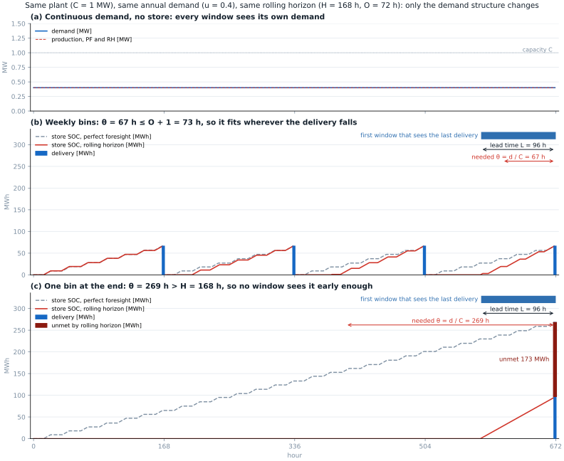
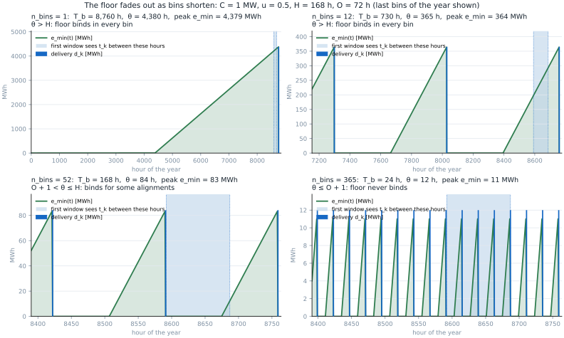
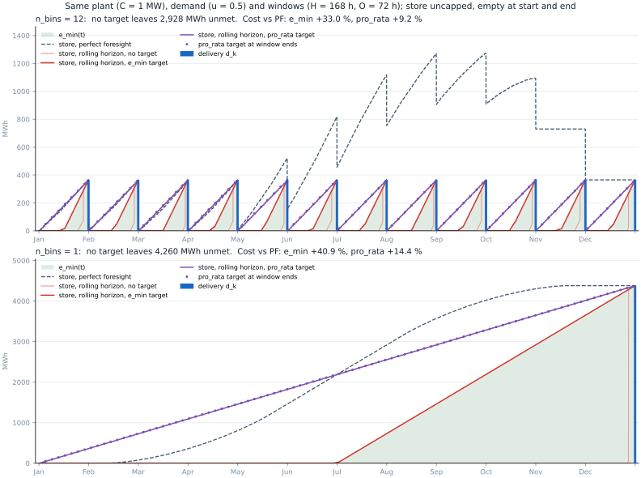

.. _guide-rolling-horizon:

Rolling Horizon Dispatch Optimisation
======================================

The rolling horizon (RH) pipeline runs a **dispatch-only** optimisation on a
network whose capacities have already been fixed by a previous capacity
expansion run.  It is useful for:

- Evaluating how a fixed plant configuration performs in a different weather or
  price year (cross-year analysis).
- Running high-resolution dispatch on a large network without solving a full
  investment problem.

When rolling horizon is enabled, Snakemake targets the RH output directly and
the ``solve_network`` (capacity expansion) rule is **never triggered**.

---

How it works
------------

1. The OPT network produced by the capacity expansion run is loaded.
2. All capacities are fixed: ``p_nom = p_nom_opt``, ``p_nom_extendable = False``.
3. *(Cross-year only)* All year-dependent time series (wind/solar capacity
   factors, electricity and gas prices, RFNBO constraints, product sale prices)
   are replaced with data from ``rh_year``.
4. Each product delivery store gets a stock target at the end of every window,
   so that binned deliveries can be met; see :ref:`rh-deliveries`.
5. A rolling horizon dispatch solve is run: the year is split into overlapping
   windows of ``horizon`` snapshots, each solved sequentially with ``overlap``
   snapshots of carry-over to avoid end-of-window artefacts. The loaded network
   keeps its time resolution, so snapshots are hours only for an hourly network.
6. The result is saved as a NetCDF network file containing the dispatch
   time series at that resolution.

---

Configuration
-------------

All settings live under the ``rolling_horizon`` key in ``config/config.yaml``:

.. code-block:: yaml

   rolling_horizon:
     enabled: false          # set true to activate the RH pipeline
     horizon: 168            # window size in snapshots (168 = 1 week at 1 h)
     overlap: 24             # overlap between consecutive windows in snapshots
     network_path: null      # REQUIRED: path to the .nc OPT network to load
     rh_year: null           # optional: dispatch year (defaults to En_price_year)
     delivery_target: pro_rata   # e_min | pro_rata | none

.. list-table:: Parameters
   :header-rows: 1
   :widths: 20 10 70

   * - Parameter
     - Type
     - Description
   * - ``enabled``
     - bool
     - Activates the RH pipeline. When ``true``, ``rule all`` targets the RH
       output instead of the standard plots.
   * - ``horizon``
     - int
     - Rolling window size in snapshots. At 1 h resolution, typical values are
       168 (week) and 720 (month). At 3 h, 168 snapshots cover three weeks.
   * - ``overlap``
     - int
     - Snapshots of overlap between consecutive windows. Reduces boundary
       artefacts. A value of 24 is usually sufficient.
   * - ``network_path``
     - string
     - Absolute or relative path to the optimised ``.nc`` network.
       **Required** when ``enabled: true``.
   * - ``rh_year``
     - int / null
     - Year whose weather and price data are used for dispatch. If ``null``
       or equal to ``En_price_year``, the same data as the capacity expansion
       run is used.
   * - ``delivery_target``
     - string
     - Stock target at the end of each window for product delivery stores:
       ``pro_rata`` (default), ``e_min`` or ``none``. See :ref:`rh-deliveries`.

The cost of delivery energy a window cannot make is
``targets.load_shedding_cost`` (see :ref:`demand-load-shedding`). The rolling
horizon always adds the ``unmet delivery`` generator to keep every window
feasible, at 10 000 €/MWh when that key is ``null``. The former
``rolling_horizon.unmet_cost`` is still read and takes precedence.

---

Same-year mode
--------------

Use this when you want to run dispatch on the same year as the capacity
expansion without re-solving the full investment problem.

.. code-block:: yaml

   rolling_horizon:
     enabled: true
     horizon: 168
     overlap: 24
     network_path: outputs/single_analysis/.../networks/..._OPT.nc
     rh_year: null

---

Cross-year mode
---------------

Use this to evaluate the optimised capacities under a different year's
weather and energy prices.  The network topology and component sizes remain
exactly as in the OPT network; only the time series data is replaced.

.. code-block:: yaml

   rolling_horizon:
     enabled: true
     horizon: 168
     overlap: 24
     network_path: outputs/single_analysis/.../networks/..._OPT.nc
     rh_year: 2019   # dispatch with 2019 wind/solar CFs and electricity prices

The preprocessed inputs for ``rh_year`` (``data/Inputs_2019/``) must exist.
If they do not, Snakemake will run ``preprocess_inputs`` for that year
automatically before the RH solve.

---

Running
-------

With ``enabled: true`` and ``network_path`` set, run Snakemake as normal:

.. code-block:: bash

   snakemake --cores 4

Snakemake's DAG will target only the RH output.  No capacity expansion rule
is triggered.

---

Output
------

The result is saved as a NetCDF file at:

.. code-block:: text

   {outputs_folder}/{network_name}/networks/rolling_horizon/{network_name}_RH.nc

Load it with PyPSA to access the full dispatch time series:

.. code-block:: python

   import pypsa
   n = pypsa.Network("path/to/network_RH.nc")

   n.generators_t.p                    # generator dispatch [MW]
   n.links_t.p0                        # link flow at bus0 [MW]
   n.stores_t.e                        # store energy content [MWh]
   n.storage_units_t.state_of_charge   # storage state of charge [MWh]

---

What changes between years
--------------------------

When ``rh_year`` differs from ``En_price_year``, the following are replaced
with data from ``data/Inputs_{rh_year}/``:

.. list-table::
   :header-rows: 1
   :widths: 50 50

   * - Data
     - Source file
   * - Wind capacity factors
     - ``CF_wind.csv``
   * - Solar capacity factors
     - ``CF_solar.csv``
   * - Electricity spot price (buy / sell)
     - ``Elspotprices_input.csv``
   * - Natural gas price
     - ``NG_price_year_input.csv``
   * - RFNBO hourly import constraint
     - derived from electricity price
   * - Product sale prices (bioCH4, etc.)
     - derived from NG price + CO₂ cost

Capital costs, efficiencies, network topology, and component capacities are
**not** changed — they come from the OPT network.

----

.. _rh-deliveries:

Product deliveries in rolling horizon
--------------------------------------

This section uses the symbols of :ref:`demand-formulation`.

The problem
^^^^^^^^^^^

A window optimises :math:`H` snapshots, keeps the first :math:`S = H - O` and
hands its stock to the next window:

.. math::

   s_j = j\,S, \qquad \tau_j = s_j + S - 1

:math:`s_j` is the first snapshot of window :math:`j` and :math:`\tau_j` the
last one it keeps. A window sees only the deliveries :math:`d(t)` inside it.
With a continuous demand every window has demand. With bins most windows have
none, so they produce nothing, and the window that finally sees a delivery may
start too late.

At capacity :math:`C`, bin :math:`k` needs :math:`\theta_k = d_k / C` hours of
production. The first window that contains :math:`t_k` starts
:math:`L_k` hours before it, with :math:`O + 1 \le L_k \le H`. Without help
the bin is met only if

.. math::

   \theta_k \le L_k

   Same plant, demand total and windows; only the demand structure changes.
   (b) :math:`\theta \le O + 1`: met. (c) :math:`\theta > H`: the last window
   sees the delivery 96 h ahead and makes 96 of the 269 MWh due. Generated by
   ``docs/_static/demands/generate_rh_bins_figure.py``.

The demand is set, not forecast. The rolling horizon may therefore use the whole
delivery schedule :math:`d(t)`, which the windows cannot see, without knowing
anything about future prices or weather.

Stock targets
^^^^^^^^^^^^^

``scripts/delivery_targets.py`` gives the delivery store a lower target
:math:`f` at every hand-over :math:`\tau_j` and an upper bound in every
snapshot:

.. math::

   f(\tau_j) \;\le\; e(\tau_j) \qquad\qquad e(t) \;\le\; D(T-1) - D(t) + e_c

The target is built from two stock paths:

.. math::

   e_{\min}(t-1) = \max\big(0,\; e_{\min}(t) + d(t) - C\,\Delta t\big), \qquad e_{\min}(T-1) = e_c

.. math::

   e_{\text{pr}}(t) = d_k\,\frac{t - t_{k-1}}{t_k - t_{k-1}} \qquad t_{k-1} < t < t_k

- :math:`e_{\min}(t)` is the least stock that keeps every later delivery
  reachable at full capacity. Before a bin it is zero, then rises with slope
  :math:`C` over the last :math:`\theta_k` hours.
- :math:`e_{\text{pr}}(t)` is the stock if each bin were produced at a constant
  rate since the previous delivery.

``rolling_horizon.delivery_target`` combines them:

.. list-table::
   :header-rows: 1
   :widths: 18 32 50

   * - Value
     - :math:`f(t)`
     - Effect
   * - ``pro_rata``
     - :math:`\max(e_{\min},\, e_{\text{pr}})`
     - Production keeps pace with each bin. The default.
   * - ``e_min``
     - :math:`e_{\min}`
     - Feasible, but production is pushed as late as possible.
   * - ``none``
     - 0
     - Diagnosis only: shows what a plain rolling horizon misses.

The target gives every window a demand, including windows without a delivery:

.. math::

   d_j = \sum_{\tau_{j-1} < t_k \le \tau_j} d_k \;+\; f(\tau_j) - f(\tau_{j-1})

The :math:`d_j` add up to :math:`A`. A window may produce more than
:math:`d_j` when power is cheap, up to the upper bound. Production costs money,
so in practice it produces close to :math:`d_j`.

The upper bound is the demand still to come. It binds only when producing is
free or pays, for instance at negative prices, and stops a window from filling
the store with product that has no buyer.

:math:`e_c` is the stock the first deliveries need before the plant can make
them. It is zero unless an early bin is larger than :math:`C` can produce from
1 January. The store starts and ends the year with :math:`e_c`, as the cyclic
store of the capacity-expansion run does.

Cases
^^^^^

.. list-table::
   :header-rows: 1
   :widths: 28 72

   * - Case
     - What the target does
   * - Continuous demand (``flat``, ``profile``)
     - :math:`e_{\text{pr}} = 0` and :math:`e_{\min} = 0` unless
       :math:`d(t) > C\,\Delta t`, so there is no target. The store keeps its
       size :math:`E`, which is the ``flexibility`` the user set.
   * - Bins, :math:`\theta_k \le O + 1`
     - Every window sees its deliveries in time; :math:`e_{\min}` never binds.
       ``pro_rata`` still stops production from being left to the end of a bin.
   * - Bins, :math:`O + 1 < \theta_k \le H`
     - Whether a window sees a delivery in time depends on where :math:`t_k`
       falls in the window grid. :math:`e_{\min}` covers the late cases.
   * - Bins, :math:`\theta_k > H`
     - No window sees a delivery early enough. Without a target every bin fails.
   * - Window shorter than a bin, :math:`H < T/n`
     - Most windows contain no delivery; :math:`d_j` comes only from
       :math:`f`. With ``pro_rata``, :math:`d_j \approx d_k\,S\,n/T`.
   * - Large unequal bins (``bins_profile``)
     - :math:`e_{\min}` can reach back past the previous delivery, so stock
       must be carried across the bin end.

For bins the store limit :math:`E` of the capacity-expansion run is lifted; the
plant capacity already limits how far production can run ahead. The
capacity-expansion run itself keeps :math:`E`.

   :math:`e_{\min}` over the last bins of the year. Shorter bins give shorter,
   lower ramps. Once a ramp fits in the overlap, the target stops binding.

Capacity and risk
^^^^^^^^^^^^^^^^^

:math:`C` is the capacity of the links into the delivery bus, also limited by
the plants behind the product collection bus. It is a rating, not a forecast.
The rolling horizon must not know future wind or prices, so the targets
assume the plant can run at :math:`C` in every hour.

.. warning::

   **The targets can fall short.** They guarantee every delivery only if the
   plant can run at :math:`C` whenever needed. When its supply depends on the
   weather, for instance an electrolyser larger than its grid connection, a
   calm spell before a large bin can leave it below :math:`C`. The window then
   makes less than :math:`e_{\min}` assumed.

   The shortfall goes to an ``unmet delivery`` generator at
   ``targets.load_shedding_cost``. It keeps every window feasible and is
   reported at the end of the solve as ``deliveries unmet``. Check the log
   after every rolling-horizon run. This is an intrinsic risk of limited
   foresight, not an error. A longer window usually removes it.
   :ref:`tutorial-3b-rolling-horizon-bins` shows a case.

Tests
^^^^^

   Toy plant, :math:`C` = 1 MW, :math:`A/(C\,T)` = 0.5, :math:`H` = 168 h,
   :math:`O` = 72 h. Generated by
   ``docs/_static/demands/generate_rh_emin_figures.py``.

Renewables, biogas, electrolysis, storage and symbiosis; 200 GWh/y of hydrogen
in ``bins_profile`` bins, 350 GWh/y of methane flat; 2024 at 4 h resolution,
``delivery_target: pro_rata``:

.. list-table::
   :header-rows: 1
   :widths: 14 20 22 22 22

   * - Case
     - Bins
     - :math:`H` / :math:`O`
     - Hydrogen unmet
     - OPEX vs perfect foresight
   * - 1
     - 12 (monthly)
     - 14 d / 3 d
     - 0
     - +4.2 %
   * - 2
     - 26 (two-weekly)
     - 30 d / 7 d
     - 637 MWh (0.3 %)
     - +3.3 % plus the unmet penalty
   * - 3
     - 12 (monthly)
     - 30 d / 7 d
     - 0
     - +3.3 %

In case 2 the electrolyser draws 83 MW but has 54 MW of grid connection, so in
late November it could not run at :math:`C` in every hour.
:ref:`tutorial-3b-rolling-horizon-bins` walks through the same case. With
``delivery_target: none`` the default configuration leaves 680 of 9,000 MWh of
methanol unmet; with ``pro_rata`` it leaves none.

----

Custom constraints in rolling horizon
--------------------------------------

The capacity expansion solve applies several custom constraints via
``extra_functionality`` that are not part of the standard PyPSA model.
The RH solve must replicate these constraints in every window, otherwise
the RH dispatch is less constrained than the PF solve and the cost
comparison is meaningless.

RE export fraction constraint
^^^^^^^^^^^^^^^^^^^^^^^^^^^^^^

The most important custom constraint limits how much renewable electricity
the site may sell back to the grid relative to the amount it consumes
on-site:

.. math::

   E_{\text{export, window}} \leq \alpha \times E_{\text{consumed, window}}

where :math:`\alpha` is ``max_RE_to_grid`` from ``config.yaml``.

**In the perfect-foresight (PF) solve** this is a single annual constraint:
the full-year export total must not exceed :math:`\alpha` times the full-year
on-site consumption total.

**In rolling horizon** the constraint cannot be applied as a single annual
expression, because each window is solved as an independent optimisation
problem with its own linopy model that only contains the window's snapshots.
Instead the same constraint is added to *every window* using the window's own
snapshot set — effectively enforcing the fraction locally within each 168-hour
(or chosen ``horizon``) period.

This per-window enforcement is **strictly tighter** than the original annual
constraint: if the fraction is satisfied in every window it is guaranteed to be
satisfied over the full year.  The practical consequence is that the RH
dispatch may curtail slightly more RE or shift slightly more production
internally compared to a hypothetical annual-constraint RH, but the direction
of the bound is always conservative.

.. warning::

   Omitting this constraint from the RH solve causes the optimizer to export
   far more electricity to the grid than the PF solve (observed: 2.5× more
   annual export in an unconstrained RH run), making the RH total system cost
   appear lower than PF.  This is an artefact, the system is "profiting" from
   unplanned grid exports rather than using the electricity for green fuel
   production.  The constraint must always be applied to both solves to ensure
   a fair comparison.

Implementation
^^^^^^^^^^^^^^

The constraint is injected via the ``extra_functionality`` hook that PyPSA's
``optimize_with_rolling_horizon`` passes to each per-window ``n.optimize()``
call:

.. code-block:: python

   def _rh_extra_functionality(n, snapshots):
       m = getattr(n, "model", None)
       if m is None:
           return
       add_max_RE_sales_constraint(
           n, m,
           bus="El3",
           export_pattern="El3_to",
           export_bus="ElDK1 sell bus",
           alpha=c.max_RE_to_grid,
           name="El3_export_fraction_of_total_RE",
           n_flags=c.n_flags,
           include_agents=["biogas", "electrolysis", "methanation", "meoh"],
           snapshots=snapshots,   # <-- window snapshots, not full-year
       )

   n.optimize.optimize_with_rolling_horizon(
       ...
       extra_functionality=_rh_extra_functionality,
   )

The ``snapshots`` argument is critical: without it,
``add_max_RE_sales_constraint`` would call ``_snapshots_by_scenario(n)`` and
receive the full 8760-snapshot index, but the linopy model variables only
contain the current window's timestamps, causing a ``KeyError`` when the
function tries to select non-existent snapshots from the model variables.

Adding a new custom constraint to the PF solve
^^^^^^^^^^^^^^^^^^^^^^^^^^^^^^^^^^^^^^^^^^^^^^

A new ``extra_functionality`` constraint added to ``helpers.py`` for the
capacity expansion run **must** also be added to ``_rh_extra_functionality`` in
``scripts/snakemake_rolling_horizon.py``. Pass ``snapshots=snapshots``, or an
equivalent window-aware argument, so that the constraint operates on the
current window's snapshots rather than on the full network index.

---

See also
--------

- `PyPSA rolling horizon example <https://docs.pypsa.org/latest/examples/rolling-horizon/>`_ — original PyPSA documentation and worked example
- :ref:`config-rolling-horizon` — GreenBubble configuration reference
- :ref:`guide-temporal-resolution` — reduce snapshot count before solving
